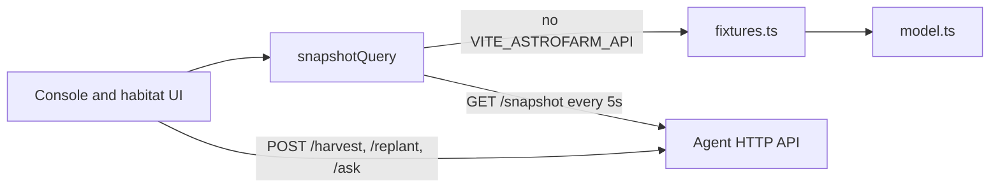
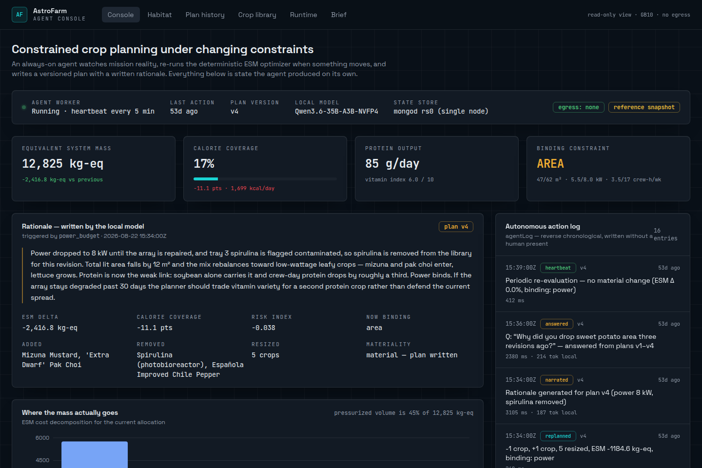
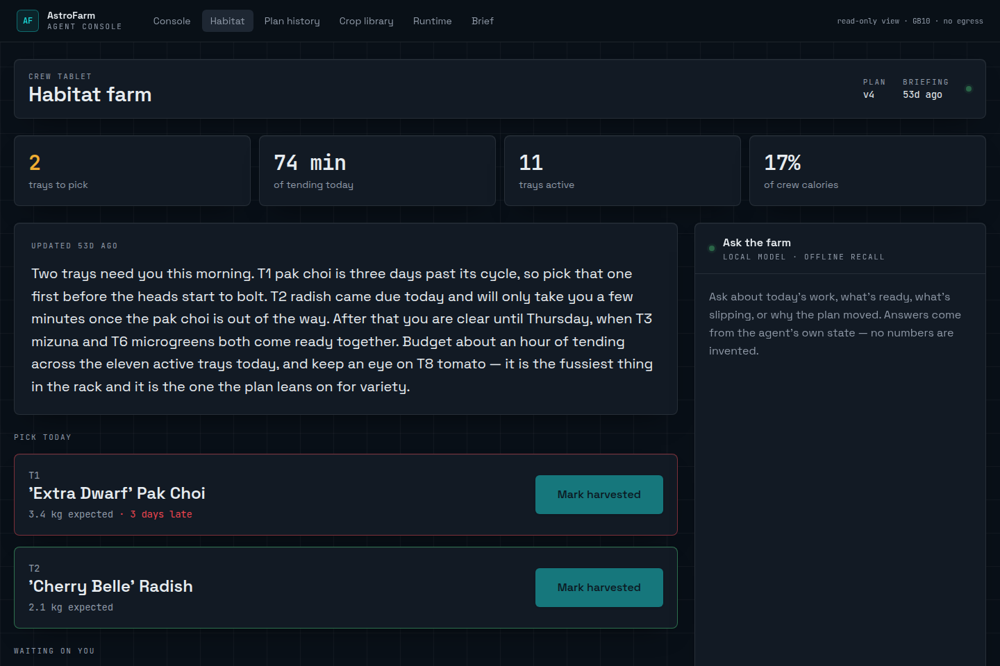
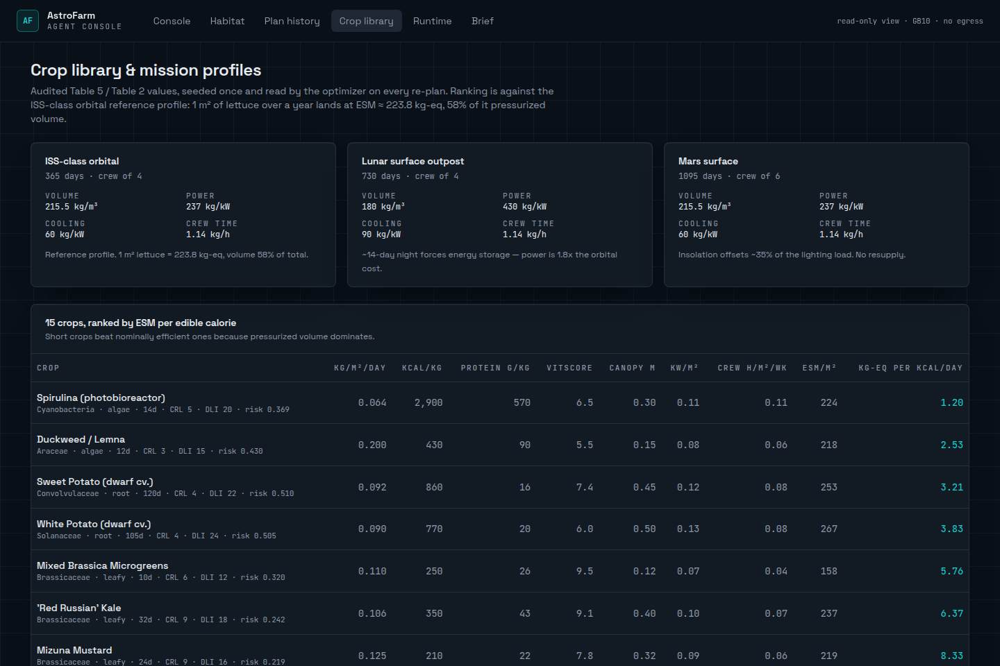

# AstroFarm

Local agent console for constrained crop planning. This repository is the web UI: a read-only mission view of versioned crop allocations, equivalent system mass (ESM), constraint events, and a crew habitat tablet.

With no agent URL configured, every page renders a bundled reference snapshot. Point `VITE_ASTROFARM_API` at a worker that speaks the snapshot API and the same screens read live state. The Python agent, MongoDB replica set, and local model server described on the Runtime page are outside this repository.

Public portfolio project for Shay Bouchles. Built in [Lovable](https://lovable.dev) and kept in sync with [this Lovable project](https://lovable.dev/projects/3c1ba1d4-4e14-404a-8bd1-870ea21c30ee).

## What it does

| Route | Screen |
| --- | --- |
| `/` | Latest plan: status, ESM and nutrition summary, written rationale, ESM breakdown, allocation table, optimizer curve, recent constraint events, and the autonomous action log. |
| `/habitat` | Crew tablet: briefing, trays ready to pick, replant proposals, a 12-tray board, and a question box. |
| `/plans` | Plan history. Each revision keeps the trigger, the diff against the previous plan, and the rationale. |
| `/plans/$version` | One revision. Unknown versions render the plan-not-found view. |
| `/library` | Three mission profiles and 15 crops, ranked by ESM per edible calorie on the ISS-class orbital profile. |
| `/runtime` | Process map, collection list, agent-loop sketch, and build order for the companion stack. Static page. |
| `/brief` | Positioning copy: buyer, workflow, stated impact, and a five-minute demo order. Static page. |

The header labels the console a read-only view. Habitat harvest and replant actions stay disabled until an agent endpoint is set. Offline questions are answered from the snapshot by `localAnswer` in `src/lib/astrofarm/assistant.ts`.

## Stack

Declared in `package.json` and installed from `bun.lock`.

- React 19
- TanStack Start, TanStack Router (file routes in `src/routes`), and TanStack Query
- Vite 8
- Nitro, using the Cloudflare module preset when `vite build` runs (from `@lovable.dev/vite-tanstack-config`)
- Tailwind CSS 4
- Radix UI primitives (shadcn-style components in `src/components/ui`)
- Recharts for the ESM breakdown and optimizer curve
- TypeScript 5

`zod`, `react-hook-form`, and much of the UI kit ship with the Lovable template. Feature screens use a small subset (button, badge, table, tooltip, textarea).

## Architecture

```
src/routes/*          file routes and page composition
src/router.tsx        router + QueryClient
src/server.ts         SSR entry; turns swallowed 500s into an HTML error page
src/start.ts          request error middleware and CSRF protection for server functions
src/lib/astrofarm/
  client.ts           snapshot query: fixture, or GET {VITE_ASTROFARM_API}/snapshot
  fixtures.ts         reference snapshot (plans, events, log, trays, briefing)
  data.ts             crop library and three mission profiles
  model.ts            deterministic ESM math used by the fixture and the library page
  assistant.ts        offline answers, and POST {base}/ask when an endpoint is set
```



`fetchSnapshot` expects `GET {base}/snapshot` to return a `ConsoleSnapshot` (`src/lib/astrofarm/types.ts`). On a non-OK response the root error view asks for a retry. When the endpoint is set, the query refetches every 5 seconds.

Habitat writes, only when that endpoint is set:

- `POST {base}/harvest` with `{ trayId }`
- `POST {base}/replant` with `{ trayId }`
- `POST {base}/ask` with `{ question }`, reading `{ text, grounded? }`

`model.ts` prices an allocation as system mass plus make-up water, pressurized volume, power, cooling (a fixed fraction of electrical load), and crew time. The file's acceptance check is 1 m² of lettuce on the ISS-class orbital profile for 365 days: mass 63.4, volume 129.3, power 22.2, cooling 5.1, crew time 3.8, total 223.8 kg-eq. Running `cropEsm` in this repo reproduces those figures. The library page ranks crops with `esmPerKcal` against that same profile.

The reference snapshot's plan summaries are `summarize()` outputs for the allocations in `fixtures.ts`. Its optimizer curve is generated there so the chart has a shape. This repository does not contain a search procedure that produced those steps.

`data.ts` comments label crop readiness, family, cycle length, yield, calories, daily light integral, canopy height, and crew time as audited table values, and label protein, `vitScore`, and most water figures as assumed. The footer and the Brief page still call the coefficients a reconstruction. Both texts are in the repo; they disagree.

The Runtime page describes a single-box companion: `mongod` as a single-node replica set, a local model server, a Python agent watching `constraintEvents`, and this UI. None of those processes are implemented here.

## Setup

Node.js 22 and [Bun](https://bun.sh) (this repo's lockfile is `bun.lock`). Verified with Node.js 22.14.0 and Bun 1.4.3.

```sh
bun install
bun run dev
```

The dev server prints a local URL, by default `http://127.0.0.1:5173` when started with `--host 127.0.0.1 --port 5173`.

```sh
bun run build
bun run preview
```

`bun run lint` currently fails on existing Prettier formatting. See Known issues.

### Agent endpoint

Copy the example file and set the base URL in `.env` (no trailing path; the client calls `/snapshot`):

```sh
cp .env.example .env
```

```
VITE_ASTROFARM_API=http://127.0.0.1:8787
```

Leave it unset to keep the reference snapshot. `.env` is gitignored. `.env.example` lists the variable name only.

## Screenshots

Local dev server, reference snapshot, no agent endpoint. Desktop viewport, 1440×960.

### Console



### Habitat



### Crop library



## Contributors

Commit authors in `git shortlog` for this repository (59 commits, 20–22 August 2026):

| Author | Commits |
| --- | --- |
| [gpt-engineer-app[bot]](https://github.com/gpt-engineer-app) | 57 |
| Lovable \<noreply@lovable.dev\> (`Lovable`) | 1 — TanStack Start template |
| Lovable \<noreply@lovable.dev\> (`lovable`) | 1 — previous README |

Shay Bouchles is the GitHub owner (`shaythegay13`). The author strings above are the full `git shortlog` for this history.

## Known issues

- `bun run lint` reports 55 Prettier errors and 6 `react-refresh/only-export-components` warnings in the existing UI kit. The production build succeeds.
- Vite prints that `vite-tsconfig-paths` is redundant with native `resolve.tsconfigPaths`. The plugin comes from the Lovable Vite config.
- The Brief page and the site footer still say crop coefficients are a reconstruction. `src/lib/astrofarm/data.ts` and the library page describe the same tables as audited, with protein, `vitScore`, and most water demand marked assumed.
- The footer says the console never writes plans or events. With `VITE_ASTROFARM_API` set, Habitat can `POST` a harvest or a replant.
- Fixture timestamps are fixed at 22 August 2026 so server and client markup match. After hydration, relative times tick from the real clock, so labels read as many days ago when the app is opened later.
- `package.json` `"name"` is still `tanstack_start_ts`, the Lovable template name.
